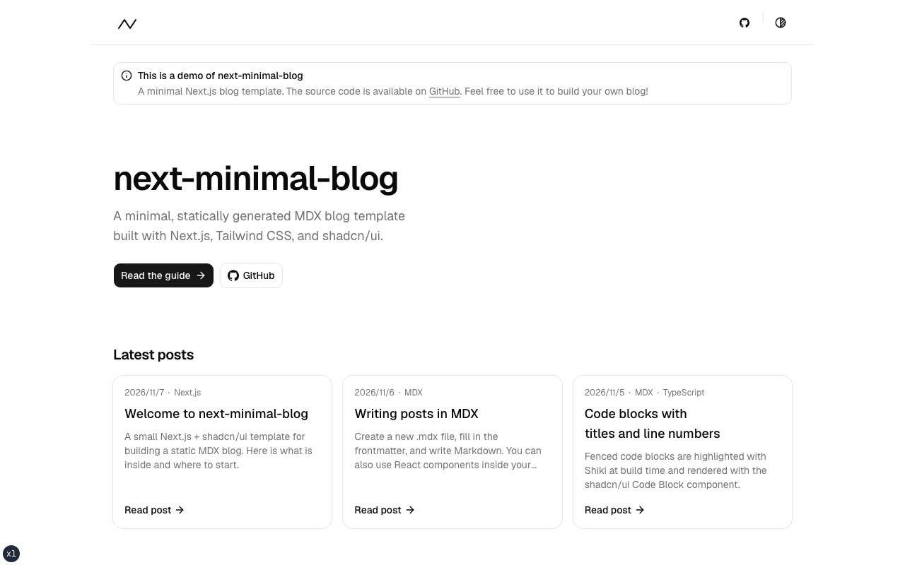

# Next.js Minimal Blog Template

This is a lightweight, minimalistic blog template built with Next.js 16, MDX, Tailwind CSS, and shadcn/ui.



## Tech Stack

- Framework - [Next.js](https://nextjs.org) (v16)
- Language - [TypeScript](https://www.typescriptlang.org)
- Styling - [Tailwind CSS](https://tailwindcss.com) (v4)
- UI Components - [shadcn/ui](https://ui.shadcn.com) (base-nova style, powered by [Base UI](https://base-ui.com))
- Static Content Management - [MDX](https://mdxjs.com)
- Syntax Highlight - shadcn/ui [Code Block](https://ui.shadcn.com/docs/components/code-block) + [Shiki](https://github.com/shikijs/shiki) (highlighted at build time)
- Deployment - [Vercel](https://vercel.com)
- Code Linting - [ESLint](https://eslint.org) (v9, Flat Config + `eslint-config-next`)
- Code Formatting - [Prettier](https://prettier.io)

## Project Philosophy

This project follows a **minimalist approach** to building a **Next.js-based MDX blog**.

- **Official-First**: Prioritize using **official Next.js libraries** to ensure stability and maintainability.
- **Minimal & Fast**: Keep the project **lightweight and fast**, avoiding unnecessary dependencies.

## Project Structure

The app code lives in `src/`, set up the same way `npx shadcn@latest init` does for a Next.js app with a `src` directory.

```txt
src/
  app/                  # Next.js App Router (pages, layouts, globals.css)
  components/
    ui/                 # shadcn/ui components (generated by the CLI)
    blog/               # Post card, post list, pagination, share buttons ...
    layout/             # Site header, footer, breadcrumb, theme switcher
    mdx/                # MDX rendering (code block, callout, link preview, component map)
    shared/             # Small shared pieces (icons, logo)
    theme-provider.tsx  # Generated by the CLI (press `d` to toggle dark mode)
  content/blog/         # Blog posts (.mdx)
  hooks/                # React hooks (generated by the CLI)
  lib/                  # Loading posts, tags, OG metadata, highlighter, utils
```

### About shadcn/ui components

All shadcn/ui components that only depend on Base UI are already installed in `components/ui`.
Unused components are not included in the JavaScript bundle.

The following components need extra npm packages, so they are **not** installed by default. Add them when you need them:

```sh
pnpm dlx shadcn@latest add carousel chart calendar command input-otp resizable
```

### Code blocks in MDX

Fenced code blocks are rendered with the shadcn/ui Code Block at build time. Supported meta:

````md
```tsx title="app/page.tsx" showLineNumbers
export default function Page() {}
```
````

To support more languages, add them to `src/lib/highlighter.tsx`.

## Running Locally

Follow these steps to set up and run the project on your local machine.

### Clone the repository

> [!NOTE]
> This repository is set as a Public Template, so you can use it as a template by clicking "Use this template"!

```sh
git clone git@github.com:cakegaly/next-minimal-blog.git
cd next-minimal-blog
```

### Install dependencies & Set up environment variables

```sh
pnpm i
cp .env.example .env.local
```

`NEXT_PUBLIC_APP_URL` is the public URL of your site. It is optional: when it is not set, the production domain is used on Vercel, and `http://localhost:8888` is used locally. See `src/lib/config.ts`.

### Build the project

```sh
pnpm build
```

### Start the development server

```sh
pnpm dev
```

### Open in your browser

Visit **[http://localhost:8888](http://localhost:8888)** to see the site in action 🎅

## Deployment

This project is automatically deployed on **[Vercel](https://next-minimal-blog-delta.vercel.app/)**.

## License

This project is licensed under the **MIT License**.

## Thanks

This project was inspired by and heavily influenced by the following open-source projects:

- [shadcn/ui](https://github.com/shadcn-ui/shadcn-ui) – The best UI library for building modern, accessible design systems. This incredible project served as the foundation for the design of this template.
- [shadcn/taxonomy](https://github.com/shadcn-ui/taxonomy) – A well-structured and minimal approach to building content-driven applications with Next.js and shadcn/ui.
- [astro-nomy](https://github.com/mickasmt/astro-nomy) – A beautifully designed Astro blog template that influenced the content and design philosophy of this project.

---

If you find this project useful, feel free to give it a ⭐ on GitHub!
